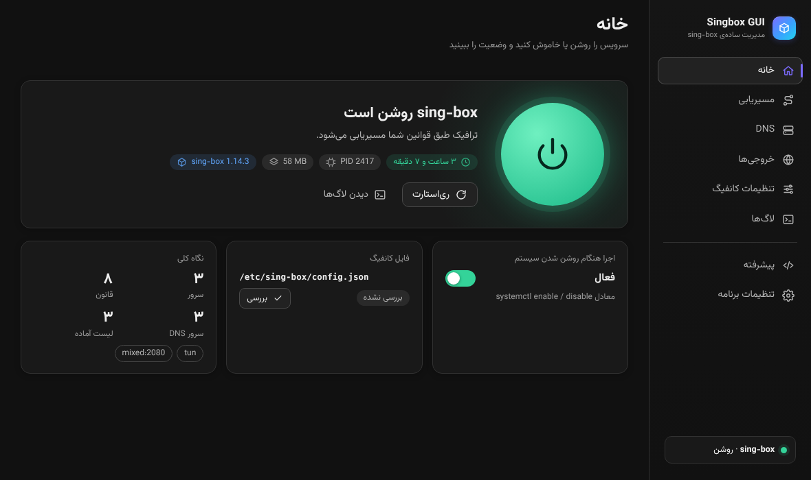
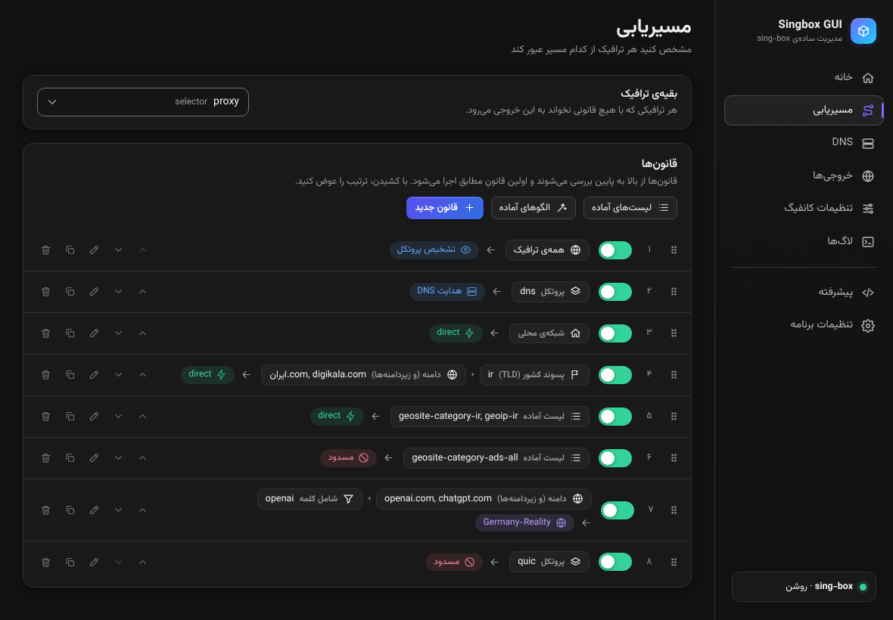
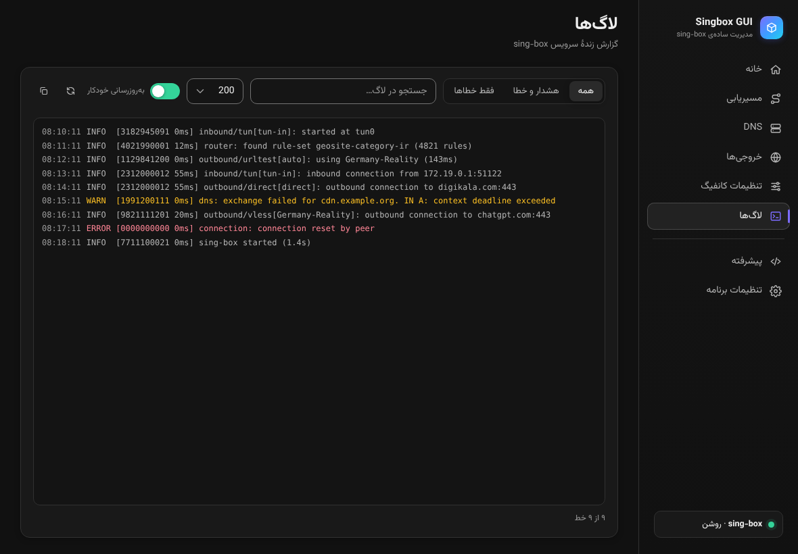

# Singbox GUI

<div dir="rtl" align="right">

اپ دسکتاپ ساده و شیک برای مدیریت **sing-box** روی لینوکس — با [TinyJS](https://tinyjs.app/) ساخته شده (حدود ۱۰ مگابایت، بدون Electron).

به‌جای باز کردن دستی فایل JSON و تایپ `sudo systemctl restart sing-box`، همه‌چیز را از یک پنجره انجام می‌دهید:

- **روشن/خاموش کردن سرویس** با یک دکمه‌ی بزرگ؛ وضعیت، مدت اجرا، مصرف حافظه و «اجرا هنگام بوت».
- **صفحه‌ی لاگ‌ها**: لاگ زنده‌ی سرویس با فیلتر سطح (همه / هشدار و خطا / فقط خطا)، جستجو، تعداد خط و به‌روزرسانی خودکار.
- **مسیریابی (Routing)**: قانون‌ها را مثل یک لیست ساده می‌سازید — *اگر* دامنه/TLD/آی‌پی/پورت/پروتکل/لیست آماده … *آنگاه* مستقیم / پروکسی / مسدود. با کشیدن مرتب می‌کنید، هر قانون را جدا فعال/غیرفعال می‌کنید.
  - الگوهای آماده: «دامنه‌های `.ir` مستقیم»، «شبکه‌ی محلی مستقیم»، «ایران (geosite/geoip)»، «بستن تبلیغات»، «QUIC بسته»، «هوش مصنوعی با پروکسی» و…
  - چسباندن یک فهرست مخلوط (دامنه، TLD، آی‌پی، `keyword:`…) و تشخیص خودکار نوع هر خط.
- **DNS**: سرور اضافه می‌کنید (نام/تگ، نوع UDP، DoH، DoT، DoQ…، آدرس) و قانون DNS می‌سازید؛ سرورهای معروف (Google، Cloudflare، Shecan، Electro…) یک‌کلیکی‌اند.
- **خروجی‌ها**: لینک `vless://`، `vmess://`، `trojan://`، `ss://`، `hysteria2://`، `tuic://` (یا کل اشتراک base64) را بچسبانید تا خودکار ساخته شود؛ گروه «انتخاب دستی» و «سریع‌ترین خودکار» بسازید. با عوض کردن نام یک خروجی، همه‌ی ارجاع‌ها خودکار درست می‌شوند.
- **پیش از ذخیره اعتبارسنجی با `sing-box check`**، بکاپ خودکار از نسخه‌ی قبلی، و ری‌استارت سرویس فقط اگر روشن است.
- ویرایشگر JSON برای کارهای پیشرفته؛ هرچه در فرم‌ها نیست دست‌نخورده می‌ماند.
- فارسی (راست‌به‌چپ) و انگلیسی، تم تیره/روشن.





## نصب

بسته‌ی `.deb` را از بخش [Releases](https://github.com/alirezajokar/singbox-gui/releases) (یا از Artifacts آخرین اجرای GitHub Actions) دانلود کنید:

```bash
sudo apt install ./singbox-gui_*_amd64.deb
```

همین. برنامه «Singbox GUI» در منوی برنامه‌ها ظاهر می‌شود (یا `singbox-gui` در ترمینال).
وابستگی‌ها (`libwebkit2gtk-4.1-0`، `pkexec` و…) خودکار نصب می‌شوند؛ خود sing-box باید جداگانه نصب شده باشد
([راهنمای رسمی](https://sing-box.sagernet.org/installation/package-manager/)).

برنامه به‌طور پیش‌فرض سرویس `sing-box.service` و فایل `/etc/sing-box/config.json` را مدیریت می‌کند؛ در بار اول مسیر واقعی کانفیگ را از خود سرویس می‌خواند و در «تنظیمات برنامه» قابل تغییر است.

## دسترسی root چطور کار می‌کند؟

خود برنامه با کاربر عادی اجرا می‌شود. فقط وقتی لازم باشد (روشن/خاموش کردن سرویس، نوشتن کانفیگ) یک ابزار کوچک و ثابت (`/usr/lib/singbox-gui/helper`) از طریق **polkit/pkexec** با رمز شما اجرا می‌شود. این ابزار فقط چند کار محدود بلد است (`systemctl start|stop|restart|enable|disable`، خواندن/نوشتن فایل‌های کانفیگ sing-box، خواندن لاگ سرویس) و ورودی‌هایش را اعتبارسنجی می‌کند؛ کانفیگ را قبل از نوشتن با `sing-box check` بررسی می‌کند و از فایل قبلی یک `.singbox-gui.bak` کنار آن نگه می‌دارد.

اگر نمی‌خواهید هر بار رمز بزنید: **تنظیمات برنامه ← دسترسی ← «بدون پرسیدن رمز»** (اختیاری و با هشدار؛ قانون polkit فقط برای همین ابزار و کاربر فعلی نوشته می‌شود). پیش‌فرض، رمز یک‌بار پرسیده و چند دقیقه نگه‌داشته می‌شود.

## ساخت از سورس (همه‌چیز روی GitHub)

لازم نیست چیزی روی سیستم خودتان نصب کنید. [`.github/workflows/build.yml`](.github/workflows/build.yml):

1. تست‌ها را اجرا می‌کند (منطق کانفیگ + اعتبارسنجی با sing-box واقعی + سناریوهای UI + بک‌اند روی txiki.js)،
2. TinyJS را (با نسخه‌ی ثابت و بررسی checksum) دانلود و برنامه را `tinyjs build` می‌کند،
3. بسته‌ی `.deb` می‌سازد، نصبش را امتحان می‌کند و برنامه را زیر Xvfb بالا می‌آورد،
4. با push یک تگ `vX.Y.Z` آن را در Releases منتشر می‌کند.

```bash
# انتشار نسخه‌ی جدید: نسخه را در tinyjs.json، package.json و src/backend/main.js یکی کنید، سپس یکی از این دو:
git tag vX.Y.Z && git push origin vX.Y.Z
# یا در GitHub: Actions ← build ← Run workflow (روی main) و گزینه‌ی release را بزنید
```

اگر خواستید محلی بسازید: `scripts/build.sh && scripts/build-deb.sh` (TinyJS را در پوشه‌ی `.tinyjs/` همین پروژه دانلود می‌کند، نه روی سیستم).

## توسعه

```bash
npm test                    # تست‌های واحد + اعتبارسنجی با sing-box (اگر نصب باشد)
node scripts/serve-mock.mjs # پیش‌نمایش UI در مرورگر با بک‌اند ساختگی (بدون root/systemd)
./scripts/dev.sh            # اجرای واقعی با hot reload (به نمایشگر نیاز دارد)
```

ساختار:

```
src/backend/      بک‌اند txiki.js: systemd، خواندن/نوشتن کانفیگ، فراخوانی helper
src/frontend/     رابط کاربری (ES modules ساده، بدون فریم‌ورک و بدون build)
  js/config.js    پیش‌نویس کانفیگ، تغییر نام امن تگ‌ها، فعال/غیرفعال کردن قوانین
  js/rules.js     قانون ⇄ مدل ویرایشگر      js/dns.js    سرورهای DNS
  js/links.js     لینک‌های اشتراک → outbound  js/presets.js  الگوها و rule-setها
packaging/        helper، سیاست polkit، فایل desktop، اسکریپت‌های deb
test/             واحد، یکپارچه با sing-box، e2e مرورگر، smoke بک‌اند
```

## عیب‌یابی

- **پنجره خالی/سیاه است** (برخی کارت‌های NVIDIA/Wayland): `WEBKIT_DISABLE_DMABUF_RENDERER=1 singbox-gui`
- **سرویس پیدا نشد**: نام سرویس را در «تنظیمات برنامه» بررسی کنید (`systemctl status sing-box`).
- **لاگ نمایش داده نمی‌شود**: کاربر شما باید عضو گروه `systemd-journal` یا `adm` باشد، یا دکمه‌ی «اجازه با رمز» را بزنید.

</div>

---

## English

**Singbox GUI** is a small desktop app (TinyJS, ~10 MB, no Electron) that manages a **sing-box** service on Linux:
one big power button (start/stop/restart/enable-at-boot), a Logs page with level filter and search, a friendly **routing rules** editor
(domains, TLDs, IPs, ports, protocols, geosite/geoip rule-sets → direct / proxy / block, drag to reorder, per-rule on/off, ready-made templates),
**DNS** servers and rules, **outbounds** (paste `vless://`, `vmess://`, `trojan://`, `ss://`, `hysteria2://`, `tuic://` links or a base64 subscription),
validation with `sing-box check` before every save, automatic backups, and a raw JSON editor for everything else (unknown fields are always preserved).
The UI is Persian (RTL) or English, dark or light.

**Install:** download the `.deb` from [Releases](https://github.com/alirezajokar/singbox-gui/releases) and run `sudo apt install ./singbox-gui_*_amd64.deb`.

**Build:** CI does everything on GitHub (tests → `tinyjs build` → `.deb` → release on `v*` tags); nothing needs to be installed on your machine.
Root actions go through a tiny polkit helper (`/usr/lib/singbox-gui/helper`) that only knows a handful of validated operations.

**Develop:** `npm test`, `node scripts/serve-mock.mjs` (browser preview with a mock backend), `./scripts/dev.sh` (real app with hot reload).

MIT licensed. The UI font is [Vazirmatn](https://github.com/rastikerdar/vazirmatn) (SIL OFL 1.1, `licenses/Vazirmatn-OFL.txt`), embedded in `src/frontend/css/fonts.css` so the app looks the same on every machine; regenerate it with `node scripts/vendor-fonts.mjs`.
